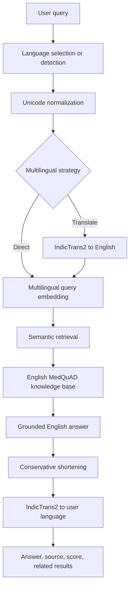

# IndicMed

**Cross-Lingual Medical FAQ Retrieval and Simplified Question Answering for Telugu, Hindi and Tamil**

IndicMed is a retrieval-grounded university NLP project for general health information in English, Hindi, Telugu, and Tamil. It retrieves an English MedQuAD answer, preserves that answer as the source of truth, and optionally translates it for presentation. It does not diagnose, prescribe, or generate unsupported medical advice.

## Architecture



The separate English experiment compares TF-IDF, BM25, and semantic retrieval. All retrievers index answer/document text while questions are queries, avoiding exact-question leakage.

## Dataset

The downloader uses the [official MedQuAD repository](https://github.com/abachaa/MedQuAD), licensed CC BY 4.0.

```powershell
python scripts\download_dataset.py
python scripts\prepare_dataset.py
python scripts\audit_dataset.py
```

The archive contains 47,441 `<QAPair>` nodes. There are 31,034 empty answers, leaving 16,407 complete pairs. Removing 48 repeated exact `(question, answer)` rows produces 16,359 unique indexed documents. The audit found 11,274 unique XML paths and no byte-identical XML files.

## Installation

English retrieval works on Windows with Python 3.10 or 3.11:

```powershell
py -3.10 -m venv .venv
.venv\Scripts\activate
python -m pip install --upgrade pip
python -m pip install -r requirements.txt
```

IndicTransToolkit is not built or tested for native Windows. Translation was validated in Ubuntu WSL using the existing `.venv-wsl` environment:

```bash
cd /mnt/f/IndicMed
source .venv-wsl/bin/activate
python -m pip install -r requirements.txt
```

Accept the Hugging Face terms for both gated models and run `hf auth login` inside WSL. Never store the token in this repository.

Translation compatibility is pinned to `transformers==4.51.3`; newer 4.57 and 5.x releases failed with the checkpoint/toolkit custom code during validation.

## Models

- Retrieval: `sentence-transformers/paraphrase-multilingual-MiniLM-L12-v2`, 384 dimensions
- English to Indic: `ai4bharat/indictrans2-en-indic-dist-200M`
- Indic to English: `ai4bharat/indictrans2-indic-en-dist-200M`
- Vector search: normalized NumPy cosine similarity; FAISS is not required

Models load lazily and are reused. CUDA is used when available; CPU remains supported.

## Build semantic embeddings

```powershell
python scripts\build_embeddings.py
```

The validated matrix has shape `(16359, 384)`, contains no NaNs, and has metadata IDs matching the dataset order.

## English retrieval experiment

Fixed seed 42, 1,000 shared questions:

| Method | Recall@1 | Recall@3 | Recall@5 | MRR |
|---|---:|---:|---:|---:|
| TF-IDF | 0.262 | 0.493 | 0.631 | 0.3944 |
| BM25 | 0.247 | 0.493 | 0.645 | 0.3874 |
| Semantic | 0.449 | 0.673 | 0.741 | 0.5652 |

```powershell
python scripts\run_evaluation.py --sample-size 1000
```

## Multilingual retrieval experiment

IndicMed keeps one English medical knowledge base rather than translating 16,359 documents. This avoids duplicated corpora, lowers storage and preprocessing cost, and keeps a single inspectable medical source of truth.

Two query strategies are compared:

1. **Direct semantic:** native Indic query → multilingual MiniLM → English document vectors.
2. **Translate semantic:** native query → IndicTrans2 English translation → multilingual MiniLM → English document vectors.

The benchmark contains 200 deterministic underlying questions (`seed=42`) and 800 aligned rows. Each English, Hindi, Telugu, and Tamil query retains the same expected document ID.

| Language | Strategy | Recall@1 | Recall@3 | Recall@5 | MRR |
|---|---|---:|---:|---:|---:|
| English | Semantic | 0.435 | 0.655 | 0.750 | 0.5564 |
| Hindi | Direct | 0.115 | 0.185 | 0.210 | 0.1505 |
| Hindi | Translate | 0.395 | 0.605 | 0.695 | 0.5096 |
| Telugu | Direct | 0.015 | 0.020 | 0.030 | 0.0198 |
| Telugu | Translate | 0.380 | 0.585 | 0.655 | 0.4882 |
| Tamil | Direct | 0.005 | 0.010 | 0.015 | 0.0088 |
| Tamil | Translate | 0.320 | 0.520 | 0.610 | 0.4321 |

Translation is therefore the UI default, while direct retrieval remains available and works without IndicTrans2 query translation.

```bash
python scripts/test_translation.py
python scripts/build_multilingual_test_set.py --sample-size 200
python scripts/run_multilingual_evaluation.py
```

Both translation generation and back-translation caching are resumable. Existing matching artifacts are reused unless `--force` is provided to the test-set builder. Retrieval metrics—not BLEU or chrF against machine-generated references—are the quantitative multilingual evaluation.

## Streamlit demo

```powershell
streamlit run app.py
```

The UI exposes all four languages, three retrieval methods, both multilingual strategies, source, similarity, related questions, grounded English answer, and translated query details. Manual language selection overrides auto-detection.

Example queries:

- English: `What are the symptoms of diabetes?`
- Hindi: `मधुमेह के लक्षण क्या हैं?`
- Telugu: `డయాబెటిస్ లక్షణాలు ఏమిటి?`
- Tamil: `நீரிழிவு நோயின் அறிகுறிகள் என்ன?`

## Tests

```powershell
pytest -q
python -m compileall -q app.py src scripts
```

Unit tests use fake encoders and translators, so they do not download model weights. Real model smoke tests are separate scripts.

## Limitations

- Exact-document evaluation can count a medically relevant neighboring FAQ as incorrect.
- Direct cross-lingual retrieval is weak for Telugu and Tamil on this English medical corpus.
- Machine translation can omit nuance; the original English answer is always retained.
- Short-query automatic language detection is imperfect, so manual selection remains available.
- MedQuAD content may be incomplete or outdated; users should consult its linked source.
- Romanized/code-mixed Indic input is not yet implemented.

## Medical disclaimer

IndicMed provides general health information retrieved from medical information sources and is not a substitute for professional medical advice, diagnosis, or treatment.

## Team

**Group 14**

- Hari Vamsi Alahari — S20240010008
- Venkata Harshith Rekapalli — S20240010203
- Karthikeya Pulluri — S20240010194
