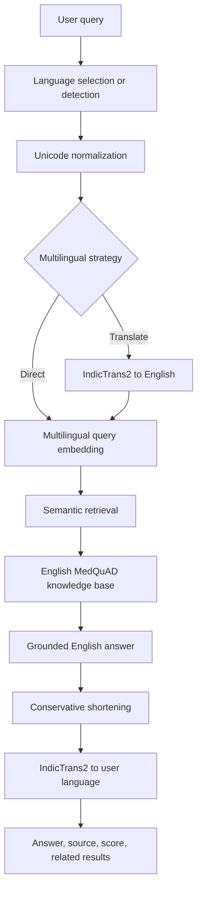

# IndicMed

**Cross-Lingual Medical FAQ Retrieval and Simplified Question Answering for Telugu, Hindi and Tamil**

IndicMed is a retrieval-grounded university NLP project for general health information in English, Hindi, Telugu, and Tamil. It retrieves an English MedQuAD answer, preserves that answer as the source of truth, and optionally translates it for presentation. It does not diagnose, prescribe, or generate unsupported medical advice.

The primary application is now **React + Vite with a FastAPI backend**. The original Streamlit `app.py` remains available as a fallback. All NLP modules, model configurations, preparation/evaluation scripts and recorded research results are retained.

## Run the application (Ubuntu WSL)

Use Python 3.10/3.11 and Linux Node.js **22.12+** inside WSL. This machine's distribution is named `Ubuntu-22.04` (`wsl -d Ubuntu-22.04` from PowerShell). Run the following in two separate WSL terminals. Keep using the existing `.venv-wsl`; do not create a replacement environment.

Install Python dependencies once, from the repository root:

```bash
cd /mnt/f/IndicMed
source .venv-wsl/bin/activate
python -m pip install -r requirements.txt
```

Start the API:

```bash
cd /mnt/f/IndicMed
source .venv-wsl/bin/activate
uvicorn backend.main:app --reload --reload-dir backend --reload-dir src --host 127.0.0.1 --port 8000
```

Start the frontend:

```bash
cd /mnt/f/IndicMed/frontend
npm ci
npm run dev
```

Open **http://localhost:5173** in the Windows browser. The API is at **http://localhost:8000** and its interactive documentation is at **http://localhost:8000/docs**. Stop either server with Ctrl+C. `npm ci` is only needed initially or when the lockfile changes.

On this machine, Node 22 was installed at `~/.local/node-v22.23.4` during migration. If `node` is unavailable in a new WSL terminal, run this before the frontend commands:

```bash
export PATH="$HOME/.local/node-v22.23.4/bin:$PATH"
node --version
npm --version
```

The supplied dataset and semantic index are reused. Starting either server does **not** download MedQuAD, rebuild embeddings, or load ML models. The first question loads only the needed models from the Hugging Face cache (or downloads missing model files when online). Cached resources are reused until the Python process restarts. English requests do not invoke translation. For a fully offline installation with complete model caches, set `HF_HUB_OFFLINE=1 TRANSFORMERS_OFFLINE=1` before the backend command. Never put Hugging Face tokens in frontend environment files.

For a fresh checkout without data/indexes, use the existing preparation commands below once, then build semantic embeddings. Do not rerun evaluation scripts to set up the UI: they write research results.

## Web/API structure

```text
frontend/
  src/components/       # Search, retrieval settings, evidence, theme controls
  src/pages/            # Application orchestration and UI states
  src/hooks/            # Request lifecycle and theme persistence
  src/services/         # Fetch transport, timeouts and safe API errors
  src/styles/           # Responsive light/dark design
  src/test/             # Focused component and HTTP client tests
  e2e/                  # Opt-in real API desktop/mobile browser checks
backend/
  main.py               # Routes, CORS and sanitized error responses
  schemas.py            # Validated request/response contracts
  services/pipeline.py  # Lazy pipeline reuse and inference locking
src/                    # Original NLP implementation, unchanged
scripts/smoke_api.py    # Opt-in real model checks; prints, never saves metrics
app.py                  # Original Streamlit UI, unchanged
```

`POST /api/ask` delegates directly to `IndicMedPipeline.ask()`. Successful answers retain the existing response fields: `query`, `detected_language`, `selected_language`, `english_query`, `retrieval_strategy`, `answer`, `translated_answer`, `source`, `source_url`, `similarity_score`, `document_id`, `category`, `related_questions` and `translation_warning`. In direct retrieval, `english_query` retains the native retrieval query; the interface explains that English canonicalization is used separately for validation. `answer` is the original pipeline's conservatively shortened grounded English answer.

### Medical scope and retrieval evidence

The web application now validates medical intent and retrieval evidence separately. Existing successful answer fields remain available, with additive `status: "success"`, `retrieved_question`, `retrieval_query` and `validation` fields. Valid requests can also return HTTP 200 with `status: "out_of_scope"`, `"insufficient_evidence"` or `"clarification_needed"`. These responses omit `answer` and `translated_answer`; clients must check `status` before displaying an answer. Input errors still use HTTP 422 and unavailable dataset/service failures use HTTP 503 with safe structured messages.

The application gate combines explicit healthcare/non-healthcare context in all four languages, rare terminology extracted from MedQuAD FAQ titles, and contrastive similarities against small medical and non-medical intent examples using the **existing MiniLM encoder**. It recognizes medical acronyms with context: AL amyloidosis is medical, while AL baseball standings and TB hard-drive questions are not treated as diseases. Bare references such as “Is it serious?” request clarification. Person names are not blacklisted; a question about someone's disease has medical intent but may lack retrievable evidence.

Indic questions are canonicalized to English with the existing IndicTrans2 instance for validation, including in Direct mode. **Direct retrieval still sends the original native-language query to MiniLM.** Translation failure or missing validation support causes an explicit abstention instead of a guessed domain decision. Clearly unrelated native-language contexts can be rejected without translation. Translations and default query embeddings use bounded in-memory caches under the existing inference lock; failures are not cached.

After retrieval, an optional pipeline callback checks the originally selected top FAQ **before answer translation**. The callback does not change ranking, rerank candidates, synthesize answers or alter research callers that omit it. It checks topic coverage, the requested question facet (such as symptoms, causes or diagnosis), and query-to-FAQ-title similarity. Topic/facet checks use the same shortened English excerpt that will be displayed. A matching term alone is insufficient to approve an answer.

`config/validation_policy.json` contains independently fitted policies for 15 method/strategy/language routes, bound to the dataset SHA-256 and configured embedding model. The policy does **not** apply a universal raw-score cutoff across TF-IDF, BM25, English queries and cross-language queries. Cutoffs are fitted jointly with topic/facet support; a false topic accept is penalized three times as much as withholding a supported topic. A route with no positive calibration support abstains. A changed dataset/model or missing policy requires recalibration before supported answers can be shown.

The new authored development fixtures and reports live under `validation/`, separate from the preserved experiments in `outputs/`. Run calibration explicitly only when changing the application policy, model, corpus or fixtures:

```bash
cd /mnt/f/IndicMed
source .venv-wsl/bin/activate
HF_HUB_OFFLINE=1 TRANSFORMERS_OFFLINE=1 python scripts/calibrate_validation.py
# For rule-only reporting/refitting on the exact same cases, dataset and model,
# reuse measured cosine scores and translations; recompute lexical evidence:
python scripts/calibrate_validation.py --reuse-observations
# With FastAPI running, execute the actual multilingual application checks:
python scripts/check_application.py
```

Validated TF-IDF/BM25 requests also use the shared MiniLM encoder for the evidence guard. If it cannot be loaded, the API abstains instead of bypassing validation. Ask requests have a five-minute browser timeout; comparisons allow ten minutes for both sequential branches.

These small fixtures include 48 calibration and 30 initially held-out examples. The latter were inspected while fixing failures, so **they are development/regression examples, not an untouched statistical test set**. Reports distinguish false domain accepts, false domain rejects, medical-domain abstentions and medical answers withheld for weak evidence. Topic-support measurements do not establish clinical correctness, answer completeness or general domain-classification accuracy. `initial_calibration_report.json` retains the initial observations, including a false domain accept corrected during development. No original Recall@K or MRR experiments are regenerated by these commands.

### Compare Strategies

Use **Compare Strategies** below Advanced retrieval settings. `POST /api/compare` accepts only `query`, `language` and `top_k` (1–5). Both branches always use Semantic against the same dataset/index and result count, independently of the Ask retrieval settings. The inference lock covers the whole operation; branches run sequentially and reuse the same loaded models, query translation and repeated answer translations. For English, one inference is reused because the query representations are equivalent.

Each branch returns a successful grounded answer or its own abstention/error status. A failed branch does not hide a successful branch. Accepted cards show the actual retriever query, retrieved FAQ title, translated answer, source, score and document ID, with the original grounded English answer in technical details. Rejected cards withhold answer text and allow inspection of candidate question/source/document/score metadata only. Both cards use the label **RETRIEVAL SIMILARITY SCORE**; scores do not declare a live-query winner. The expandable benchmark table reproduces the previously recorded evaluation-set Recall@1, clearly distinguished from live-query performance.

The refreshed interface uses 30–36px main headings, 22–26px section headings, 16–18px body text, 18px answers and inputs, 16px buttons, 15–16px labels and 13–14px supporting captions. Fonts are locally bundled and Indic scripts have generous line height. Comparison columns stack on tablet/mobile widths. Both themes retain accessible focus indicators and text-safe rendering.

```bash
curl http://localhost:8000/api/health
curl http://localhost:8000/api/options
curl -X POST http://localhost:8000/api/ask \
  -H 'Content-Type: application/json' \
  -d '{"query":"What is asthma?","language":"auto","retrieval_method":"semantic","multilingual_strategy":"translate","top_k":3}'
```

- `/api/health` reports process liveness, independently of dataset/model readiness.
- `/api/options` reads supported choices and configured UI defaults without initializing models.
- Questions are limited to 4,000 characters, result counts to integers 1–5. Unknown fields/settings are rejected with HTTP 422. Direct retrieval requires Semantic; controls explain and disable incompatible choices without changing a selection.
- Missing FAQs return HTTP 404. Missing/incompatible data, indexes, checkpoints or translation dependencies return HTTP 503 with setup guidance. Unexpected failures return HTTP 500. Errors use `{ "code": "...", "message": "..." }`; internal exceptions, paths and credentials are not sent to the browser.
- An answer translation failure retains an evidence-approved English grounded answer, returns HTTP 200 with a sanitized warning, and is clearly labeled as an English fallback. A query translation/intent-validation failure returns an explicit `clarification_needed` response without medical answer text; it never silently changes the chosen strategy.
- One pipeline is cached per Python process. A nonblocking lock protects initialization, retriever caching and translation inference. Concurrent inference requests receive HTTP 503 `pipeline_busy` with `Retry-After: 5`; health/options remain available. Use **one Uvicorn worker** to avoid duplicate model/GPU memory.
- Browser requests time out after five minutes. Editing a question or setting aborts its browser request, clears the answer, and ignores late responses. Python model inference already in progress continues safely under the lock; wait before retrying if the API reports busy.

Vite [proxies `/api`](https://vite.dev/config/server-options#server-proxy) to `http://127.0.0.1:8000`. Copy `frontend/.env.example` to `frontend/.env.local` only if customization is needed. `API_PROXY_TARGET` changes the development backend target; `VITE_API_BASE_URL` changes the public API prefix/origin at build time. All `VITE_` values are public. Restart Vite after environment changes. Development CORS permits only `http://localhost:5173` and `http://127.0.0.1:5173`.

Vite enables file polling inside WSL so changes made by a Windows IDE to `/mnt/f/IndicMed` trigger hot reload reliably.

For later deployment, `npm run build` produces `frontend/dist`. Serve those static assets with `/api` reverse-proxied to FastAPI, or set `VITE_API_BASE_URL` and configure the backend's allowed origin explicitly for the deployment. `npm run preview` previews the built assets on port 4173; it is not an API proxy or a production server. Fonts are bundled locally. Retrieved answers are rendered as text; source links allow only HTTP/HTTPS URLs without embedded credentials. Similarity scores are raw retrieval scores, not percentages or clinical confidence.

## Architecture



The separate English experiment compares TF-IDF, BM25, and semantic retrieval. All retrievers index answer/document text while questions are queries, avoiding exact-question leakage.

## Dataset

The downloader uses the [official MedQuAD repository](https://github.com/abachaa/MedQuAD), licensed CC BY 4.0.

```powershell
python scripts\download_dataset.py
python scripts\prepare_dataset.py
python scripts\audit_dataset.py
```

The archive contains 47,441 `<QAPair>` nodes. There are 31,034 empty answers, leaving 16,407 complete pairs. Removing 48 repeated exact `(question, answer)` rows produces 16,359 unique indexed documents. The audit found 11,274 unique XML paths and no byte-identical XML files.

## Installation

English retrieval works on Windows with Python 3.10 or 3.11:

```powershell
py -3.10 -m venv .venv
.venv\Scripts\activate
python -m pip install --upgrade pip
python -m pip install -r requirements.txt
```

IndicTransToolkit is not built or tested for native Windows. Translation was validated in Ubuntu WSL using the existing `.venv-wsl` environment:

```bash
cd /mnt/f/IndicMed
source .venv-wsl/bin/activate
python -m pip install -r requirements.txt
```

Accept the Hugging Face terms for both gated models and run `hf auth login` inside WSL. Never store the token in this repository.

Translation compatibility is pinned to `transformers==4.51.3`; newer 4.57 and 5.x releases failed with the checkpoint/toolkit custom code during validation.

## Models

- Retrieval: `sentence-transformers/paraphrase-multilingual-MiniLM-L12-v2`, 384 dimensions
- English to Indic: `ai4bharat/indictrans2-en-indic-dist-200M`
- Indic to English: `ai4bharat/indictrans2-indic-en-dist-200M`
- Vector search: normalized NumPy cosine similarity; FAISS is not required

Models load lazily and are reused. CUDA is used when available; CPU remains supported.

## Build semantic embeddings

```powershell
python scripts\build_embeddings.py
```

The validated matrix has shape `(16359, 384)`, contains no NaNs, and has metadata IDs matching the dataset order.

## English retrieval experiment

Fixed seed 42, 1,000 shared questions:

| Method | Recall@1 | Recall@3 | Recall@5 | MRR |
|---|---:|---:|---:|---:|
| TF-IDF | 0.262 | 0.493 | 0.631 | 0.3944 |
| BM25 | 0.247 | 0.493 | 0.645 | 0.3874 |
| Semantic | 0.449 | 0.673 | 0.741 | 0.5652 |

```powershell
python scripts\run_evaluation.py --sample-size 1000
```

## Multilingual retrieval experiment

IndicMed keeps one English medical knowledge base rather than translating 16,359 documents. This avoids duplicated corpora, lowers storage and preprocessing cost, and keeps a single inspectable medical source of truth.

Two query strategies are compared:

1. **Direct semantic:** native Indic query → multilingual MiniLM → English document vectors.
2. **Translate semantic:** native query → IndicTrans2 English translation → multilingual MiniLM → English document vectors.

The benchmark contains 200 deterministic underlying questions (`seed=42`) and 800 aligned rows. Each English, Hindi, Telugu, and Tamil query retains the same expected document ID.

| Language | Strategy | Recall@1 | Recall@3 | Recall@5 | MRR |
|---|---|---:|---:|---:|---:|
| English | Semantic | 0.435 | 0.655 | 0.750 | 0.5564 |
| Hindi | Direct | 0.115 | 0.185 | 0.210 | 0.1505 |
| Hindi | Translate | 0.395 | 0.605 | 0.695 | 0.5096 |
| Telugu | Direct | 0.015 | 0.020 | 0.030 | 0.0198 |
| Telugu | Translate | 0.380 | 0.585 | 0.655 | 0.4882 |
| Tamil | Direct | 0.005 | 0.010 | 0.015 | 0.0088 |
| Tamil | Translate | 0.320 | 0.520 | 0.610 | 0.4321 |

Translation is therefore the UI default, while direct retrieval remains available and works without IndicTrans2 query translation.

```bash
python scripts/test_translation.py
python scripts/build_multilingual_test_set.py --sample-size 200
python scripts/run_multilingual_evaluation.py
```

Both translation generation and back-translation caching are resumable. Existing matching artifacts are reused unless `--force` is provided to the test-set builder. Retrieval metrics—not BLEU or chrF against machine-generated references—are the quantitative multilingual evaluation.

## Legacy Streamlit fallback

```powershell
streamlit run app.py
```

The UI exposes all four languages, three retrieval methods, both multilingual strategies, source, similarity, related questions, grounded English answer, and translated query details. Manual language selection overrides auto-detection.

Example queries:

- English: `What are the symptoms of diabetes?`
- Hindi: `मधुमेह के लक्षण क्या हैं?`
- Telugu: `డయాబెటిస్ లక్షణాలు ఏమిటి?`
- Tamil: `நீரிழிவு நோயின் அறிகுறிகள் என்ன?`

## Tests

Run the Python unit/API suite in WSL. These tests inject fake translation/encoding and do not download model weights:

```bash
cd /mnt/f/IndicMed
source .venv-wsl/bin/activate
python -m pytest tests -q
python -m compileall -q backend app.py src scripts tests
```

Run React component/transport tests and the production build:

```bash
cd /mnt/f/IndicMed/frontend
npm test
npm run build
```

With the real backend already running, opt into the integration smoke test:

```bash
cd /mnt/f/IndicMed
source .venv-wsl/bin/activate
python scripts/smoke_api.py
```

This tests the four requested English/Hindi/Telugu/Tamil questions with semantic translate-then-retrieve, all three Indic languages with direct semantic retrieval, and English TF-IDF/BM25. It checks evidence-approved answers and target-language script presence, or explicit answer withholding for weak Direct results, **not medical correctness or new benchmark performance**. It prints results without writing to `outputs/`, datasets or indexes.

For desktop/tablet/mobile browser integration checks, start **both** servers first. These tests use the real Telugu query and save temporary screenshots/traces under ignored `frontend/test-results/`:

```bash
cd /mnt/f/IndicMed/frontend
npx playwright install chromium
# If Chromium reports missing Linux libraries, follow Playwright's install-deps instructions.
npm run test:e2e
```

On Windows with Microsoft Edge installed, the same Playwright config selects Edge automatically. If dependencies were installed inside WSL, the browser-only runner can still be invoked from PowerShell using `node frontend/node_modules/@playwright/test/cli.js test --config frontend/playwright.config.js` from the repository root. Vite and FastAPI stay inside WSL.

### Troubleshooting

- **`node` missing or Windows npm selected:** install Linux Node 22.12+ in WSL or use the PATH command above; check `command -v node` and `command -v npm`. Both must point to Linux executables. If npm 10 fails with `edgesOut` during dependency resolution, update that Node installation's npm to 11 (`npm install -g npm@11`) and retry `npm ci`.
- **Backend unavailable:** check `curl http://127.0.0.1:8000/api/health`, start FastAPI from the repository root and confirm port 8000 is free. Vite uses a strict port 5173; stop another process occupying it instead of silently changing the origin. Use the interface's reconnect button after starting the API.
- **Missing dataset/index:** follow the existing download/prepare/build steps. Index metadata must match dataset IDs/order and the configured embedding model. The API will not regenerate either automatically.
- **Translation unavailable:** use `.venv-wsl`, retain `transformers==4.51.3` and `IndicTransToolkit==1.1.1`, accept both gated checkpoints' terms and run `hf auth login` in WSL. Confirm cached model files are complete. Direct semantic retrieval can run without query translation; answer translation still requires the English-to-Indic checkpoint and otherwise shows an explicit English fallback.
- **Slow first request or timeout:** cache loading from a Windows-mounted drive can be slow. Scope Uvicorn reload with `--reload-dir backend --reload-dir src`; scanning the whole repository can repeatedly traverse the virtual environment and dependency folders, causing delayed code reload and slow test startup. Check backend activity, allow the current inference to finish, then retry. Subsequent requests reuse models. CUDA selection and CPU behavior are unchanged from the original NLP modules; CUDA memory exhaustion returns a safe service error. Stop other GPU workloads or restart the backend with `CUDA_VISIBLE_DEVICES=""` for CPU operation.
- **Native dependency errors after switching Windows/WSL:** install and run npm consistently inside WSL. Stop a Windows Vite/esbuild process using this checkout before `npm ci --include=optional`; a Windows process can lock shared binaries. Keep the lockfile. Component tests use jsdom 26 and a shared worker because the mounted filesystem has slow cold imports.
- **WSL localhost cannot be reached from Windows:** verify localhost forwarding is enabled in WSL and restart WSL if necessary. Both servers deliberately bind to loopback; do not expose medical queries or development servers to a public network as a workaround.
- **Built frontend cannot reach the API:** Vite's development proxy is not part of `dist`; configure the deployment reverse proxy or a public API base URL and matching CORS origin.

```powershell
pytest -q
python -m compileall -q app.py src scripts
```

Unit tests use fake encoders and translators, so they do not download model weights. Real model smoke tests are separate scripts.

## Limitations

- Exact-document evaluation can count a medically relevant neighboring FAQ as incorrect.
- Direct cross-lingual retrieval is weak for Telugu and Tamil on this English medical corpus.
- Machine translation can omit nuance; the original English answer is always retained.
- Short-query automatic language detection is imperfect, so manual selection remains available.
- MedQuAD content may be incomplete or outdated; users should consult its linked source.
- Romanized/code-mixed Indic input is not yet implemented.

## Medical disclaimer

IndicMed provides general health information retrieved from medical information sources and is not a substitute for professional medical advice, diagnosis, or treatment.

## Team

**Group 14**

- Hari Vamsi Alahari — S20240010008
- Venkata Harshith Rekapalli — S20240010203
- Karthikeya Pulluri — S20240010194
